# MANUAL DE USUARIO:
**Sistema de Gestión Financiera Personal y Presupuestos**

**Instructor:**

José de Jesús Motta Vargas

**Integrantes:**

Julio Andrés Casanova Ramírez

Laura Daniela Isanoa Estrada

Karoll Nikol Coronado Bermeo

Juan Manuel Barreiro Polo

Jaime Andrés Ladino Montealegre

**Programa:**

Análisis y Desarrollo de Software (ADSO)

**Centro de formación:**

Centro de la Industria, la Empresa y los Servicios – SENA

**Ficha:**

3407799

Neiva – Huila

## 1. Introducción
Bienvenido al **Manual de Usuario** del sistema de **Finanzas Personales**. Esta guía detalla paso a paso cómo interactuar con cada uno de los módulos de la plataforma para llevar un registro riguroso, claro y ordenado de su economía personal.

## 2. Primeros Pasos y Autenticación
### 2.1 Registro de Cuenta Nueva

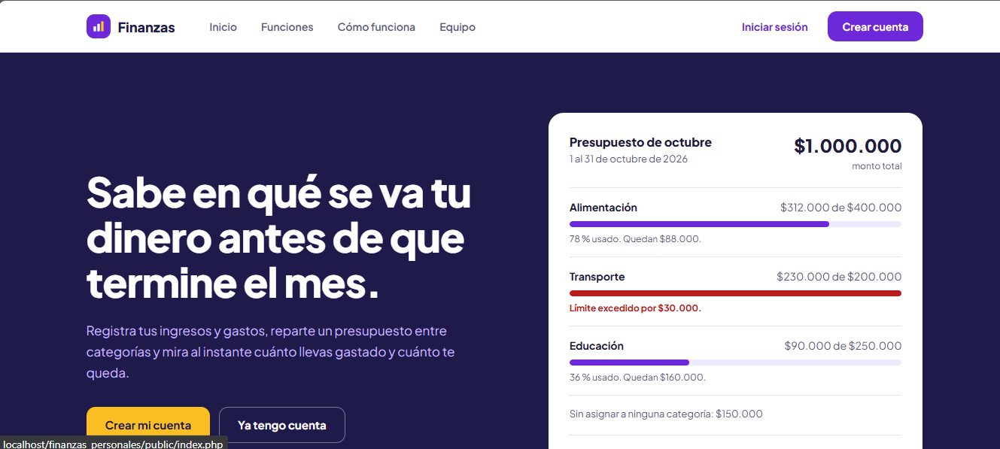

1.  Abra la aplicación web en su navegador ingresando la URL provista por su administrador o servidor local.

>

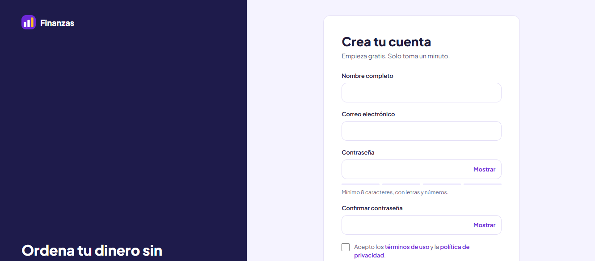

2.  Haga clic en la opción **¿No tienes cuenta? Regístrate**.

3.  Ingrese su nombre completo, correo electrónico válido y una contraseña segura.

4.  Presione el botón **Crear Cuenta**. El sistema lo redirigirá automáticamente a la pantalla de inicio de sesión.

### 2.2 Inicio de Sesión

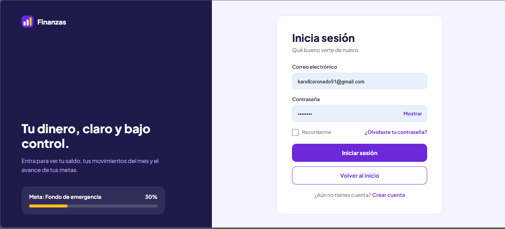

1.  Ingrese su correo electrónico registrado y su contraseña en el formulario de acceso.

2.  Haga clic en **Iniciar Sesión**. Si las credenciales son correctas, accederá al panel principal (**Dashboard**).

### 2.3 Cierre de Sesión Seguro

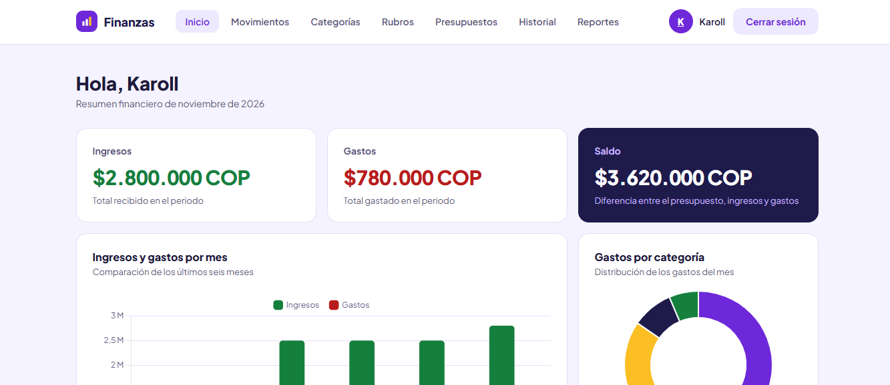

Para proteger sus datos financieros, nunca cierre simplemente la pestaña del navegador. Utilice siempre el botón **Cerrar Sesión** ubicado en la esquina superior o menú lateral del sistema.

## 3. Panel Principal (Dashboard)

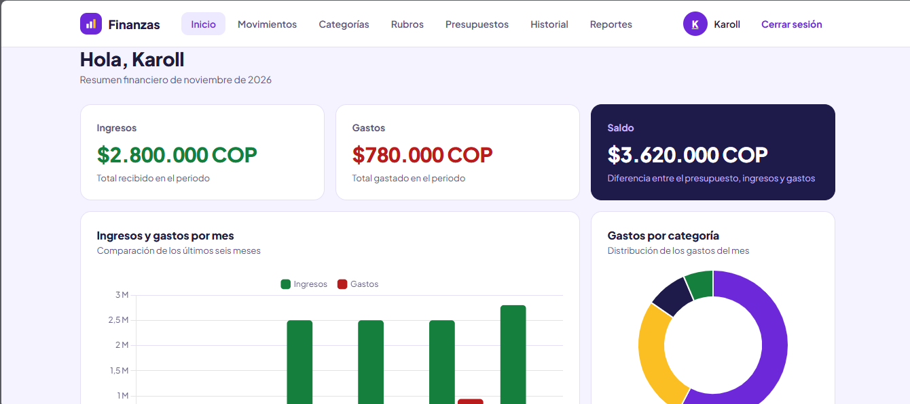

El Dashboard es su centro de control financiero. Al ingresar visualizará:

- **Tarjetas Resumen:** Indicadores rápidos del balance total, ingresos totales del mes y egresos acumulados.

- **Accesos Directos:** Botones para registrar un nuevo movimiento de manera inmediata o consultar los reportes recientes.

## 4. Gestión de Categorías y Rubros

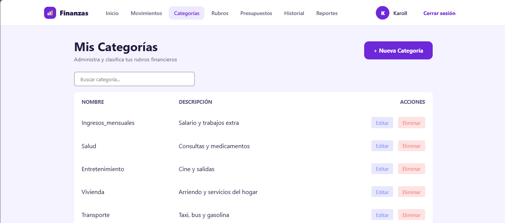

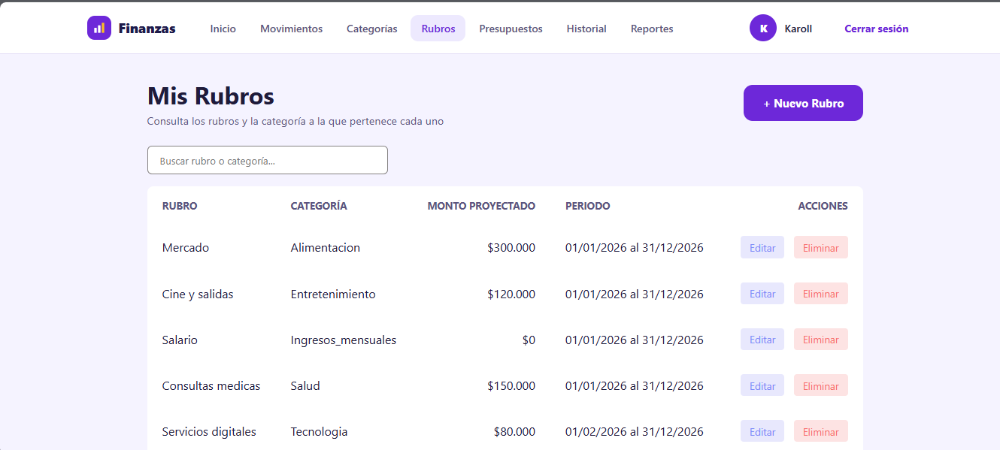

Antes de registrar movimientos detallados, es recomendable configurar sus categorías:

1.  Diríjase al menú **Categorías**.

2.  Podrá distinguir entre categorías de tipo **Ingreso** o tipo **Egreso** (por ejemplo: *Salario, Alimentación, Transporte, Servicios*).

3.  Utilice los botones de **Nueva Categoría** para agregar etiquetas personalizadas según sus necesidades de control presupuestario.

## 5. Registro y Control de Transacciones (Movimientos)

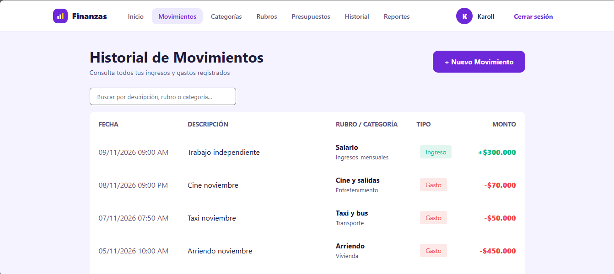

El núcleo de la aplicación radica en el registro diario de sus ingresos y gastos:

1.  Ingrese al módulo **Movimientos** o **Transacciones**.

2.  Haga clic en **Registrar Nuevo Movimiento**.

3.  Complete el formulario detallando:

    - **Tipo:** Seleccione si se trata de un ingreso o un egreso.

    - **Categoría:** Elija una de las categorías configuradas previamente.

    - **Monto:** Ingrese la cantidad numérica exacta (ej. 150.00).

    - **Fecha:** Seleccione la fecha en que ocurrió la transacción.

    - **Descripción (Opcional):** Agregue notas breves sobre el concepto del gasto o ingreso.

4.  Haga clic en **Guardar**. El registro se actualizará de inmediato en sus balances e historiales.

## 6. Consulta de Reportes Financieros

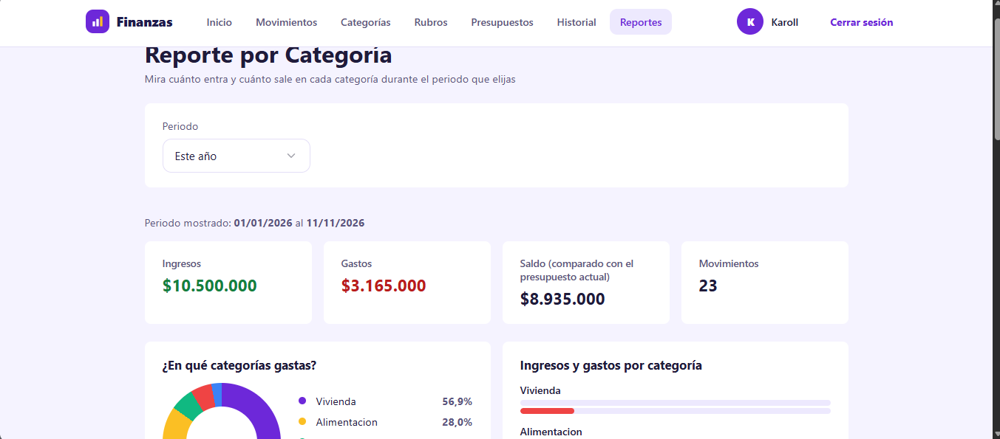

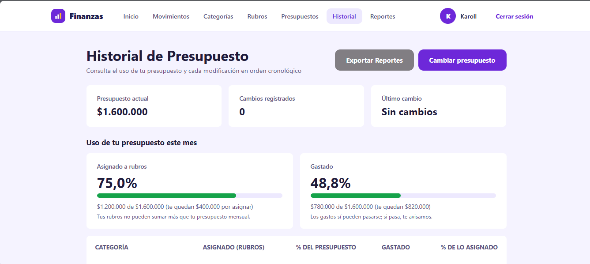

1.  Navegue al apartado de **Reportes**.

2.  Utilice los filtros interactivos por **rango de fechas** (desde / hasta) para acotar la visualización de sus movimientos.

3.  Analice el comportamiento de sus finanzas agrupadas por categorías para identificar áreas de oportunidad en su ahorro personal.

## 7. Consultas de información personal modificaciones o actualizaciones (Mi perfil)

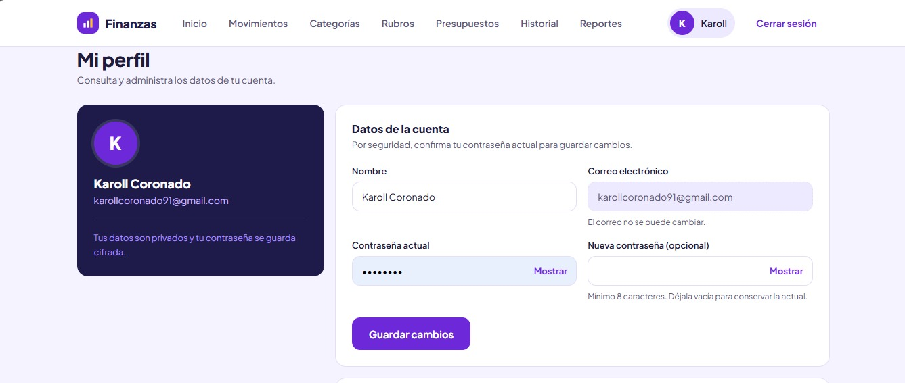

1.  Apartado del perfil de usuario con todos los datos de la cuenta..

- Nombre del usuario

- Correo electrónico del usuario.

- Confirmación de la contraseña

2.  En la parte superior se guardan los cambios o actualizaciones del perfil del usuario.

## 8. Manuales y anexos.
>

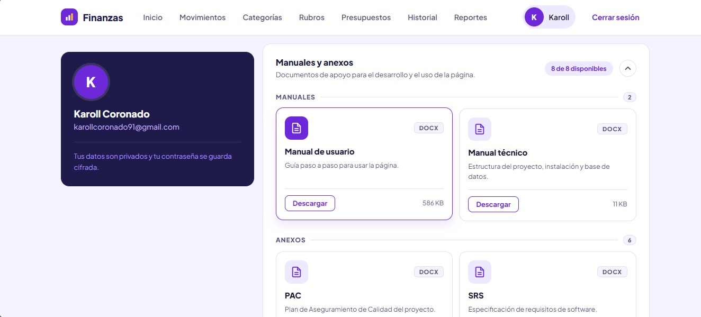

En este apartado se encontrará toda la información correspondiente al proyecto esto para garantizar que el usuario tenga total seguridad de este y conozca todo al respecto.

## 8. Eliminar cuenta.

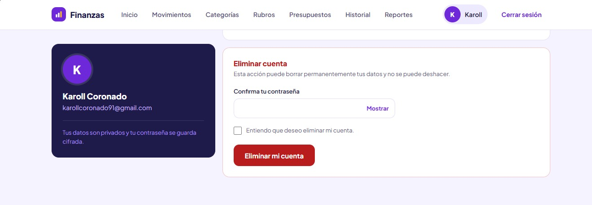

En este apartado el usuario tendrá la opción de eliminar la cuenta con el botón “Eliminar mi cuenta” si así lo desea.
